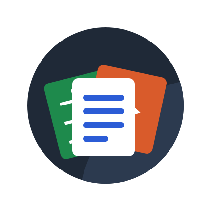
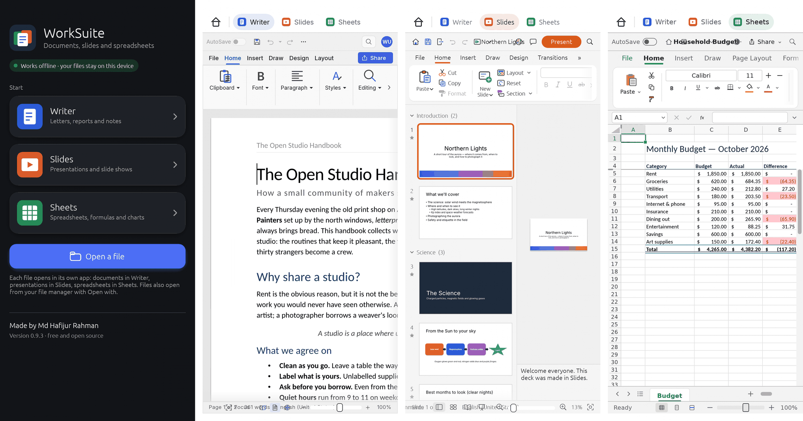
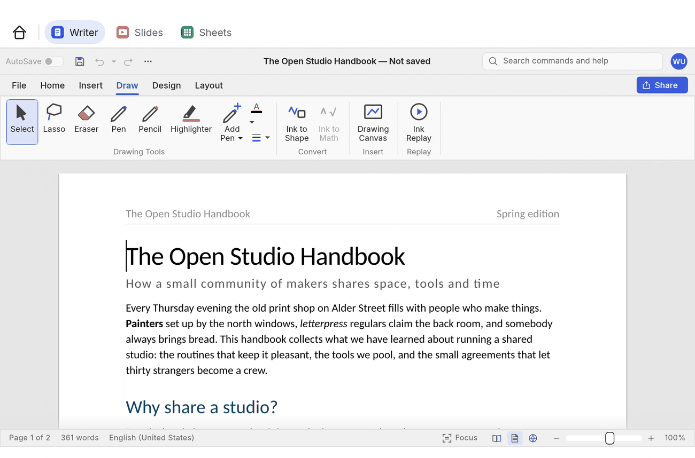

<p align="center">
  
</p>

<h1 align="center">WorkSuite</h1>

<p align="center">
  <b>A free, open-source office suite for Android: Writer, Slides and Sheets in one app.</b><br>
  Documents, presentations and spreadsheets on your phone or tablet, fully offline.
</p>

<p align="center">
  Made by <b>Md Hafijur Rahman</b>
</p>

<p align="center">
  <a href="https://github.com/Hafij-BGE/work-suite/releases/latest"></a>
</p>

<p align="center">
  
  
  
  
</p>

<p align="center">
  
  <br><sub>The home screen, Writer, Slides and Sheets on a phone.</sub>
</p>

> [!NOTE]
> WorkSuite is a **preview**: it is young, and has been tested more on a computer than on phones.
> Please report what you find in an [issue](https://github.com/Hafij-BGE/work-suite/issues).

## What's inside

| App | For | Opens and saves |
|---|---|---|
| **Writer** | letters, reports, notes, CVs | Word documents (`.docx`), OpenDocument text (`.odt`), `.rtf`, `.txt`, Markdown, HTML |
| **Slides** | presentations and slide shows | PowerPoint presentations (`.pptx`; also opens `.ppsx` slide shows) |
| **Sheets** | spreadsheets, formulas and charts | Excel workbooks (`.xlsx`), `.csv` |

All three export PDF. A home screen starts each app, and the bar at the top switches between
them; each keeps its files open while another one shows.

## Features

- **Made for phones and tablets.** A lighter ribbon with the tabs used every day, a short File
  menu, light and dark looks, and a layout that keeps clear of the status bar, the navigation bar,
  the camera cut-out and the keyboard.
- **Touch.** Drag to scroll (with a flick), pinch to zoom, tap to place the cursor, double-tap to
  select a word, long press for the menu.
- **Stylus.** An active pen (S Pen, USI and others) selects text, picks cells and moves objects
  precisely while fingers keep scrolling; it hovers, its side button opens the menu, and a hand
  resting on the screen is ignored. Pick a pen on the **Draw** tab and write or sketch: the pen
  draws, fingers scroll, and the pen's eraser end erases.
- **Your files, where they are.** Open and save with Android's own file picker, or open a file
  from your file manager with **Open with**: each file goes to the app it belongs to, and saving
  writes back to the original.
- **Back works as expected.** It closes a menu, a dialog or the File view first, then returns to
  the home screen.
- **Offline and private.** WorkSuite has no network permission at all: it cannot send anything
  anywhere, and the file picker shows only the files on your device.

<p align="center">
  
  <br><sub>Writer's Draw tab on a tablet: pick a pen and write on the page with a stylus.</sub>
</p>

## Install

1. On your phone or tablet, open the [latest release](https://github.com/Hafij-BGE/work-suite/releases/latest)
   and download `WorkSuite-<version>-android-release.apk`.
2. Open the downloaded file, and allow installing apps from your browser or file manager when
   Android asks.

Needs Android 8 or later on a 64-bit ARM device (nearly every phone and tablet from the last
several years).

**Two WorkSuite icons after installing 0.9.3?** Versions before 0.9.3 used another app id, so the
new one installs beside them. Save your documents in the old one, then uninstall it; your documents
in Downloads, Documents and other folders are not touched. From 0.9.3 on, new versions install as
updates.

## Known limits

- The on-screen keyboard types letters, digits and punctuation; Bengali and other composed scripts,
  swipe typing and autocorrect may not work yet. A hardware keyboard works.
- Copy and paste work inside the app, not yet with other apps.
- No printing: export a PDF and print that.
- Pen strokes keep the width you pick (no pressure); a rubber-tipped passive stylus works like a
  finger.
- On a phone, some ribbon groups fold into menus, and Writer's pens sit in the Draw tab's
  *Drawing Tools* menu.

What changed in each version is in the [release notes](packaging/android/release-notes.md).

## Build from source

WorkSuite is written in Rust and drawn with [egui](https://github.com/emilk/egui) on Android's
`NativeActivity`. You need Rust, the Android SDK and NDK r27c, `cargo-ndk`, JDK 17 and Gradle;
then:

```sh
packaging/android/build.sh            # debug APK in dist/release/
packaging/android/build.sh release    # release APK (signed with your key, see below)
```

The full steps, how releases are signed and published, and what differs from the desktop apps are
in [`packaging/android/README.md`](packaging/android/README.md). To look at the interface without
a phone, `cargo run -p wordcraft-android --example suite_shot -- out.ppm home dark` renders a
screenshot in software.

| Where | What |
|---|---|
| [`apps/wordcraft-android`](apps/wordcraft-android) | The Android app: the home screen and app switcher (`suite.rs`), touch, Back, insets and the stylus's eraser end |
| [`crates/`](crates) | Writer: its engine, file formats, layout and interface |
| [`deckcraft/`](deckcraft) | Slides (its own Cargo workspace) |
| [`gridcraft/`](gridcraft) | Sheets (its own Cargo workspace) |
| [`packaging/android`](packaging/android) | The Java activity (file picker, Open with, system bars), Gradle project, icon and build script |
| [`vendor/winit`](vendor/winit) | winit with a small patch that makes a stylus work as a pen ([`PATCHED.md`](vendor/winit/PATCHED.md)) |

## Credits and license

**WorkSuite** is made by **Md Hafijur Rahman**.

WorkSuite is dual-licensed under [MIT](LICENSE-MIT) or [Apache-2.0](LICENSE-APACHE), at your option.
It includes open-source code by other authors under the same licenses; their copyright notices
are kept in [LICENSE-MIT](LICENSE-MIT) and [NOTICE](NOTICE) (and in the `deckcraft/` and
`gridcraft/` folders), as those licenses require. Every bundled font, icon, image and other asset
is listed with its author, source and license in [ATTRIBUTION.md](ATTRIBUTION.md).

<sub>Microsoft, Word, PowerPoint and Excel are trademarks of the Microsoft group of companies.
WorkSuite is an independent, open-source project, not affiliated with, sponsored by or endorsed by
Microsoft; these names are used only to describe the file formats it works with.</sub>
